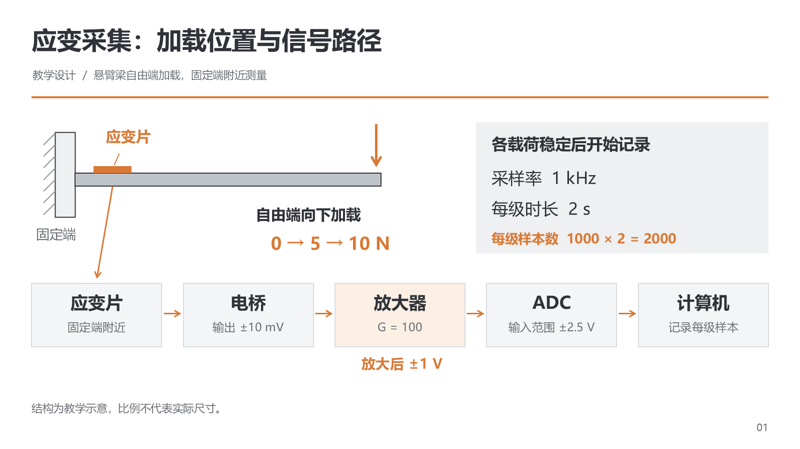
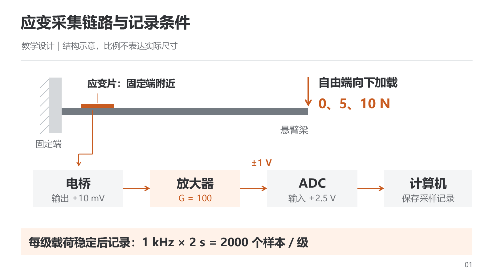
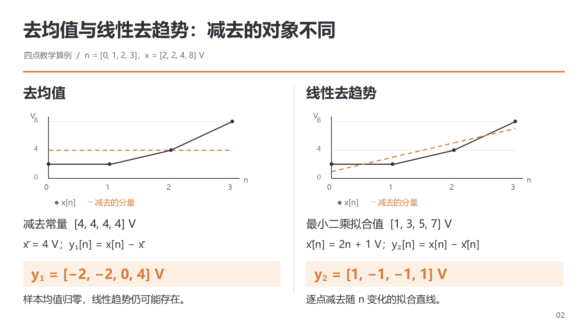
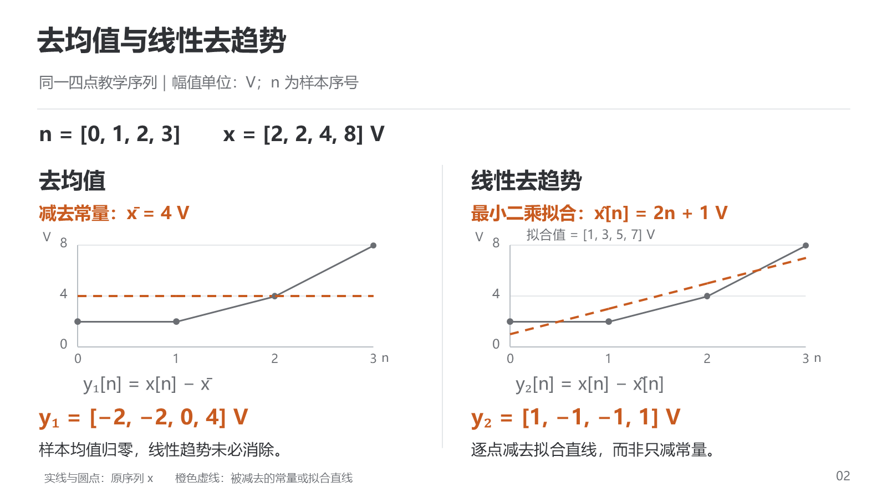
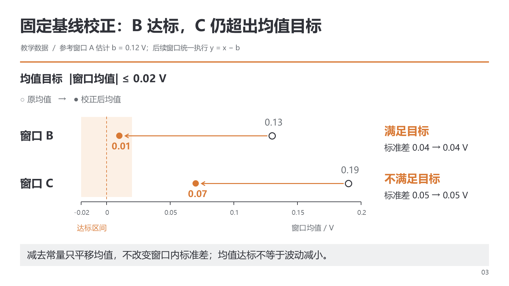
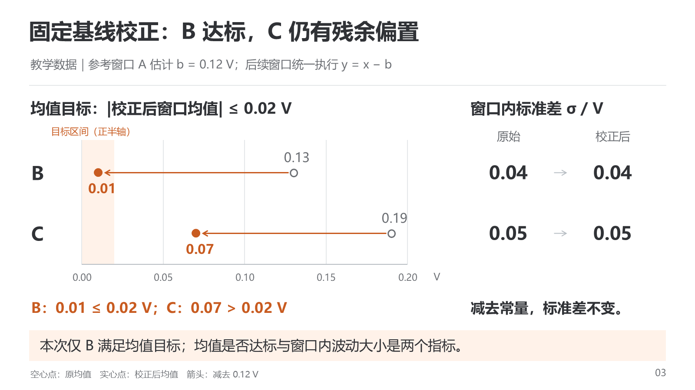
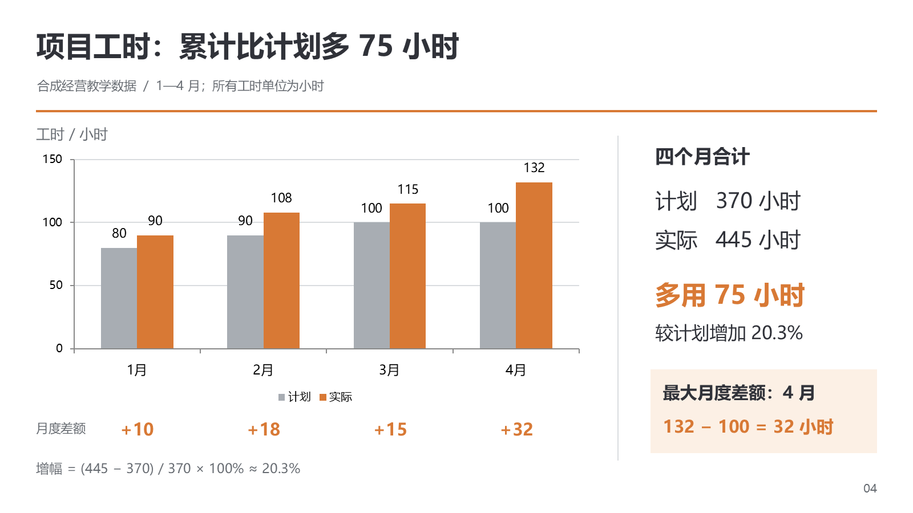
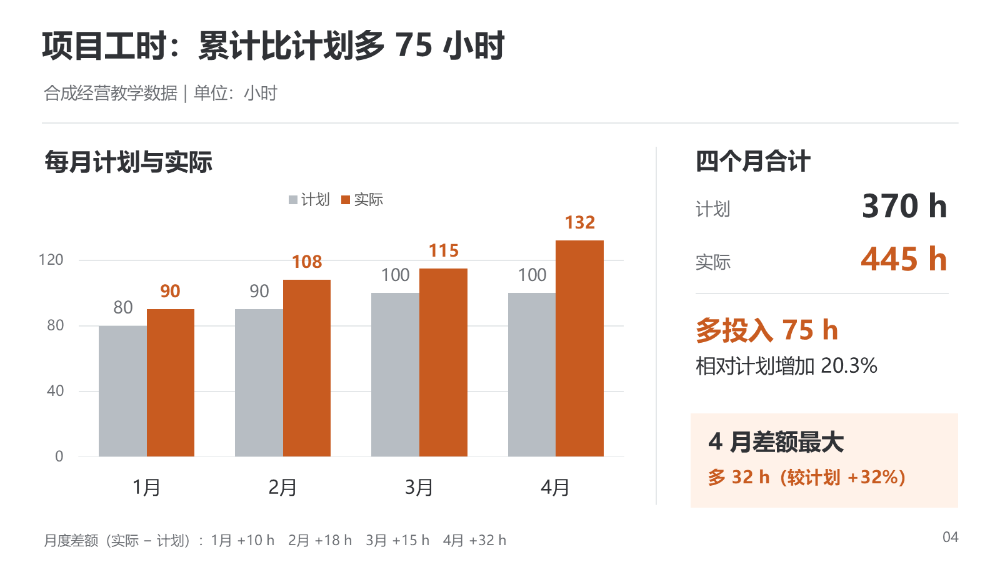

# Visual revision cases

用于需要看具体页面才能理解版式取舍的任务；不把案例的配色、数字、布局或页数当作通用模板。内容关系与稿内参数见 [设计规则](layout-and-style.md)，比较方法见 [同输入验证](paired-evaluation.md)。

## Reading a makeover

先确认原始材料和不可删的含义，再对照改前/改后实际画面：主图尺度、共同基准、邻近标注、阅读顺序发生什么变化，是否同时保留必要事实和编辑粒度。两份都清楚时记录不同取舍，不强行判新版获胜。

外部可视参考 [Storytelling with Data: Is your point clear?](https://www.storytellingwithdata.com/blog/is-your-point-clear) 逐步展示标题、图形、标注和阅读用途的调整。它的汇总方式仅适用于不需要保留分组比较的任务；不能将汇总当作通用简化办法。参考网页不等于获得图像再分发许可。

## Editable paired examples

以下四页为自制合成教学案例。两位独立执行者在同一原始材料、页数、白底暖橙方向、字体、画布和 Windows PowerPoint COM 路线下，分别读取 0.1.24 与 0.1.25 的制作规则，完成两份稿；匿名评审先看页面和材料，未获知版本映射。新版执行时尚未提供这组案例，以免把测试答案作为输入。现在公开后仅用于教学/回归，后续迁移评测须另换材料。

- [共同原始材料](../assets/paired-cases/materials.md)
- [旧版规则制作的可编辑 PPTX](../assets/paired-cases/before.pptx)
- [新版规则制作的可编辑 PPTX](../assets/paired-cases/after.pptx)
- [输入与文件哈希记录](../assets/paired-cases/case-record.json)

这不是同一历史稿的修改记录，也不是对模型能力的统计实验。两位执行者正常制作与自查；发现确切问题后，两版均允许局部修复。所有数值仅是教学设定，未使用私人项目材料或第三方图像。公开文件清除了 Office 作者/公司元数据，包含原生对象和动画的页面内容未被改动。

### Acquisition path

| 旧版规则输出 | 新版规则输出 |
| --- | --- |
|  |  |

新版把梁上的应变片直接连接到电桥，缩短从测量位置到信号路径的阅读距离，将稳定条件和采样设置汇成一处。旧版显式重复应变片节点，更易对应物理位置与电路元件，“放大后 ±1 V”也更明确。新版的 ±1 V 仍需结合连线辨认归属，不能把更紧凑认定为全面更清楚。类似页面应按听众需要选择连续路径或两层对应，并使电平贴近其实际输出段。

### Formula comparison

| 旧版规则输出 | 新版规则输出 |
| --- | --- |
|  |  |

新版放大共同输入，将被减对象置于图上方，形成输入、操作、输出的阅读顺序。旧版显式列出常量向量，与拟合向量逐点对应，便于手工核算。两版均保留同尺度双图和输出；不能将原序列与被减分量的图误称为处理后输出曲线。旧版初次图例颜色不一致，已局部修复。新版底部图例较小，面向更远观看距离时应优先调整，不能只看正文是否足够大。

### Mean and variability

| 旧版规则输出 | 新版规则输出 |
| --- | --- |
|  |  |

新版把均值变化与标准差分区，并显式列出两项阈值比较，强调两种指标不同。旧版完整显示 ±0.02 V 达标区间，同一窗口的结果与标准差靠近，便于合读；新版只画正半轴并清楚标明范围，本例没有负值，不属于数值错误。旧版初次漏写教学数据身份，已补入副标题。两种组织均可用，选择取决于主要任务是区分指标还是合读工况。

### Plan versus actual

| 旧版规则输出 | 新版规则输出 |
| --- | --- |
|  |  |

新版强调实际序列与累计总量，旧版将差额与月份对齐并保留增幅算式。两版数值和比较口径一致，都没有依据去解释超预算原因。新版首次使用形状绘图，未满足数据编辑要求；已按原有编辑粒度规则换成原生簇状柱形图并核对工作簿和缓存。最终两版都可通过图表数据编辑更改序列；形状可移动不能替代这项能力。

## Observed checks and limits

2026-11-10 在 Windows PowerPoint 16.0、Build 20326 下制作，最终八张 1600×900 PNG 已逐页查看；修复页已重渲染复核，未观察到截断、重叠或数值错误。已核对保存包关系、四页顺序、原生动画目标，以及两份工时图的缓存与嵌入工作簿。原生对象检查不代表逐项实际编辑试验。

两份稿都保留人工点击动画；旧版每页点击组数 7/2/3/3，新版为 5/2/3/3。完整逐步播放检查因电脑控制被中止而未完成，只观察到旧版第一页入场状态；不将效果写入或静态终态视为完整播放通过。使用案例学习动态时，应继续按目标运行环境检查。

可确认的是具体信息关联与强调方式的差异，尚不能证明新版对所有场景更优。保留各版优点、实际修复与限制，比只展示被挑选的“胜出页”更有助于迁移这些方法。
